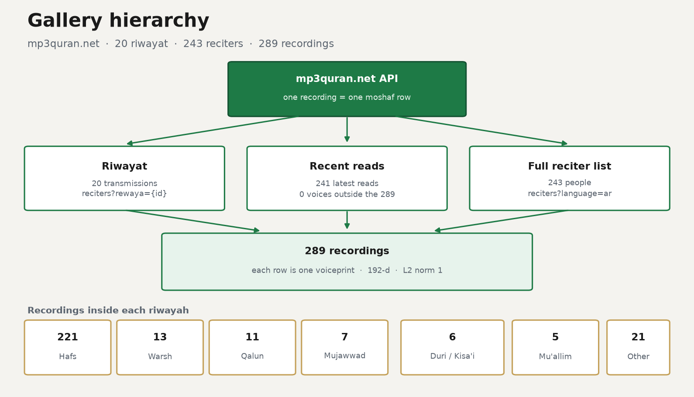
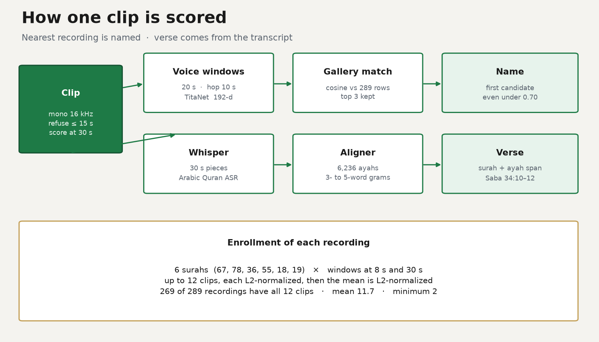

---
language:
  - ar
license: other
license_name: quran-reciter-voiceprint-1.0
license_link: LICENSE
tags:
  - audio
  - speaker-identification
  - speaker-verification
  - quran
  - recitation
  - ayah
  - surah
  - closed-set
  - titanet
  - sherpa-onnx
pipeline_tag: audio-classification
library_name: reciter-identifier
pretty_name: Quran Reciter Voiceprints
---

# Quran Reciter Voiceprints

Closed-set identifier for **243 Quran reciters** across **289 recordings**,
and a verse aligner for **114 surahs / 6,236 ayahs**.

A clip of **15 seconds or less is refused**. Pass **at least 20 seconds**.
**30 seconds** is the length this model scores: the audio is cut into
20 second windows with a 10 second hop, each window is embedded with
NVIDIA TitaNet-Small, and those unit vectors are averaged the same way
the gallery was enrolled. The named reciter is the nearest recording,
the first candidate, including when the cosine is under 0.70.

The same clip is transcribed with
[tarteel-ai/whisper-base-ar-quran](https://huggingface.co/tarteel-ai/whisper-base-ar-quran)
(downloaded on first use, not stored here) and aligned to the plain Quran
in `quran/ayahs.txt.gz`. Clips longer than 30 seconds are split first;
one pass over the whole clip returns an empty transcript. The result is
a surah and an ayah span. A line that occurs in more than one place, such
as the refrain of ar-Rahman, stays unknown.

This repository is the gallery, the verse index, and the scoring code.
It does not contain the encoder weights, the Whisper weights, or recitation audio.

Arabic, short: المقطع لازم يكون أطول من ١٥ ثانية، والأفضل ٣٠ ثانية.
النموذج يسمّي أقرب قارئ حتى لو انخفض جيب التمام عن ٠٫٧٠، ويحدد السورة والآية من
النص المنطوق.

The same gallery ships inside the Muslim app as
`assets/reciter_id/embeddings.bin`. Row order matches
`catalog.json` → `items`.

## Hierarchy



The three API calls are walked in this order. A recording is stored once.

| Source | Endpoint | What it adds |
| --- | --- | --- |
| Riwayat | `riwayat?language=ar`, then `reciters?language=ar&rewaya={id}` | 20 transmissions, 289 recordings |
| Recent reads | `recent_reads?language=ar` | 241 reads, 0 recordings outside the 289 |
| Full list | `reciters?language=ar` | 243 reciters, used for any moshaf the riwayah walk missed |

| id | Riwayah | Recordings |
| --- | --- | --- |
| 1 | حفص عن عاصم | 221 |
| 2 | ورش عن نافع | 13 |
| 3 | خلف عن حمزة | 2 |
| 4 | البزي عن ابن كثير | 2 |
| 5 | قالون عن نافع | 11 |
| 6 | قنبل عن ابن كثير | 1 |
| 7 | السوسي عن أبي عمرو | 2 |
| 8 | قالون عن نافع من طريق أبي نشيط | 1 |
| 9 | قراءة يعقوب الحضرمي بروايتي رويس وروح | 2 |
| 10 | ورش عن نافع من طريق أبي بكر الأصبهاني | 1 |
| 11 | البزي وقنبل عن ابن كثير | 1 |
| 12 | الدوري عن الكسائي | 6 |
| 13 | الدوري عن أبي عمرو | 5 |
| 15 | شعبة عن عاصم | 3 |
| 16 | ابن ذكوان عن ابن عامر | 2 |
| 18 | ورش عن نافع من طريق الأزرق | 2 |
| 19 | هشام عن ابي عامر | 1 |
| 20 | ابن جماز عن أبي جعفر | 1 |
| 21 | المصحف المعلم | 5 |
| 22 | المصحف المجود | 7 |
|  | **Total** | **289** |

Ids 14 and 17 are not in the API. Each recording is its own row. The same sheikh can appear more than once when he has more than one riwayah or style.

## How a clip is scored



| Value | Number |
| --- | --- |
| Reciters | 243 |
| Recordings | 289 |
| Embedding | 192-d, L2 norm 1 |
| Matrix bytes | 221,952 (289 × 192 × 4) |
| SHA-256 of `embeddings.bin` | `f0c2561f7ce1d66f738819dcaee9c40362931b99695cc86226fb24dd4501d1fd` |
| Surahs per recording | 6 (67, 78, 36, 55, 18, 19), then lower numbers if those are missing |
| Windows per surah | 2, starting at 8 s and 30 s, 20 s each |
| Recordings with all 12 clips | 269 |
| Mean clips | 11.7 |
| Fewest clips | 2 |
| Query windows | 20 s, hop 10 s |
| Minimum clip | longer than 15 s; 30 s is the scored length |
| Named result | first of the top 3 candidates |
| Ayahs in the aligner | 6,236 across 114 surahs |

Same-sheikh pairs (131): minimum cosine 0.505, median 0.901.
Different-sheikh pairs (19,861, seed 0): median 0.370, 99th percentile 0.672, maximum 0.819.

## What you can use it for

- Name a reciter from a clip of at least 20 seconds, when the speaker is
  one of the enrolled recordings. 30 seconds is the designed length.
- Name the surah and the ayah span the reciter is reading.
- Show the top three candidates and the cosine, and let a person confirm.
- Reject a clip of 15 seconds or less, silence, or a reciter who was
  never enrolled.

## What it does not do

- It does not verify that the audio is Quran beyond the transcript match.
- It does not clone a voice, and it must not be used to imitate a reciter.
- It does not identify a private person. The gallery is only these
  public recordings.
- It does not pick a riwayah by itself. Each recording is its own row.
  The label on that row (Hafs, Warsh, a mujawwad mushaf, a teaching
  mushaf) is metadata from the source catalog.

## Model tree

| File | What it is |
| --- | --- |
| `embeddings.safetensors` | `float32` matrix, shape `[289, 192]`, key `embeddings`. Each row is L2-normalized. |
| `embeddings.bin` | The same matrix, raw little-endian `float32`, row-major, no header. This is the file the app loads. SHA-256 `f0c2561f7ce1d66f738819dcaee9c40362931b99695cc86226fb24dd4501d1fd`. |
| `catalog.json` | One object per row: `reciterId`, `recordingId`, `nameAr`, `nameEn`, `recordingName`, plus enrollment constants. |
| `config.json` | Dimensions, threshold, top-k, encoder URL and sha256. |
| `preprocessor_config.json` | Sample rate, clip length, which surahs were enrolled. |
| `reciter_identifier.py` | Load, rank, 20 second windows, self-test, Hub upload. |
| `verse_locator.py` | Align an Arabic transcript to surah and ayah. |
| `quran/ayahs.txt.gz` | Plain text of all 6,236 ayahs, one per line. |
| `quran/surahs.json` | 114 surah names (Arabic and English) and ayah counts. |
| `handler.py` | Inference Endpoints entry point. Downloads the encoder on startup. |
| `LICENSE` | What you may do with the gallery. |

`embeddings.safetensors` and `embeddings.bin` are the same 221,952 bytes
of floats (289 × 192 × 4). Row `i` belongs to `catalog["items"][i]`.

## How a clip becomes a name

1. Audio is mono, 16 kHz, **longer than 15 seconds**. Under 20 seconds
   the call raises and names nobody. 30 seconds is the length to record.
2. Samples are float32 in `[-1, 1]`. PCM16 converts with
   `sample / 32768`.
3. The clip is sliced into **20 second windows, hop 10 seconds**. A
   window of 15 seconds or less is dropped. Each kept window is embedded
   with `nemo_en_titanet_small.onnx` (NVIDIA TitaNet-Small, 192-d).
4. Each window vector is L2-normalized. Their mean is L2-normalized
   again. Enrollment did the same with up to 12 clips per recording.
5. The pooled vector is scored by cosine against the gallery. The top 3
   rows are kept. The named reciter is the first of those rows. A cosine
   under 0.70 still names that recording. `agreement` is how many windows
   pick the same `reciterId`.
6. Whisper (`tarteel-ai/whisper-base-ar-quran`) transcribes the same
   clip in 30 second pieces. This checkpoint has no timestamp tokens, so
   one shot over 30 seconds comes back empty and the verse stays unknown.
   `verse_locator.py` aligns the words onto the mushaf and returns the
   surah plus the ayah the clip starts on and the ayah it reaches.

A different speaker model produces vectors in another space. Those
scores are meaningless against this gallery. The ONNX file must be the
one named below.

### Encoder

| | |
| --- | --- |
| File | `nemo_en_titanet_small.onnx` |
| Architecture | NVIDIA TitaNet-Small, exported for sherpa-onnx |
| Size | 40,257,283 bytes |
| SHA-256 | `ad4a1802485d8b34c722d2a9d04249662f2ece5d28a7a039063ca22f515a789e` |
| URL | https://github.com/k2-fsa/sherpa-onnx/releases/download/speaker-recongition-models/nemo_en_titanet_small.onnx |

The release tag is spelled `speaker-recongition-models` upstream. That
spelling is the real URL.

TitaNet was trained as a general speaker embedding model, including
English speech. It is used here only as a frozen feature extractor.
Nothing in TitaNet was fine-tuned on these reciters. Separation comes
from the enrolled gallery, not from a classifier head.

## Quick start

```bash
pip install numpy
python reciter_identifier.py --self-test
```

Expected line:

```text
ok 289 voices, 243 reciters, dim 192, threshold 0.7
```

Score a vector you already computed with the same encoder:

```python
from reciter_identifier import ReciterIdentifier
import numpy as np

gallery = ReciterIdentifier.from_pretrained(".")  # or "USER/quran-reciter-id"
matches, best = gallery.identify(np.load("clip_embedding.npy"))
if best is None:
    print("unknown", [(m.voice.name_en, round(m.score, 3)) for m in matches])
else:
    print(best.voice.name_ar, best.voice.name_en, best.voice.recording_name, best.score)
```

Score a wav. This installs the runtime and downloads the encoder once:

```bash
pip install numpy sherpa-onnx soundfile
python reciter_identifier.py --download-encoder nemo_en_titanet_small.onnx
python reciter_identifier.py --wav clip.wav --encoder nemo_en_titanet_small.onnx
```

`clip.wav` must be mono Quran recitation **longer than 15 seconds**
(20 minimum, 30 preferred). Resample to 16 kHz if the file is something
else. Exit code 2 means the reciter is unknown. The verse line is
printed when Whisper is installed.

From the Hub, after upload:

```python
from reciter_identifier import ReciterIdentifier

gallery = ReciterIdentifier.from_pretrained("USER/quran-reciter-id")
```

## Decision rule

| Best cosine | Meaning |
| --- | --- |
| any cosine, candidates exist | Name the first candidate. The reciter id is that row's `reciterId`. |
| no candidates | Unknown. Silence or a vector that does not rank. |
| windows disagree | `agreement` is under 0.5. The name is still the first candidate. |
| 15 seconds or less | Refused. No name, no score. |
| 20 to 30 seconds | One or two windows. 30 seconds gives two overlapping 20 second windows. |

Fifteen seconds was not a stable voiceprint against this gallery. The
enrollment clips are 20 seconds, so a query shorter than that is a
different kind of vector. Record 30 seconds. The extra time is what
the second window and the ayah aligner both use.

Top-k is 3 so a near tie can be shown. Only rank 1 is an automatic
accept, and only above the threshold, and only when the windows agree.

## Surah and ayah

`verse_locator.py` loads `quran/ayahs.txt.gz` (plain text, one ayah per
line, 6,236 lines) and `quran/surahs.json`.

1. Drop diacritics. Fold alef variants to ا, ى and ئ to ي, ة to ه, ؤ to و.
2. If the transcript is long enough and starts with the basmalah, drop
   those four words so the match is the verse after it. Al-Fatihah keeps
   its basmalah in the index, because there it is ayah 1.
3. Slide 5-word grams (4 if the transcript is shorter, 3 if it is only a
   few words) across the whole mushaf, including grams that cross an ayah
   boundary.
4. Each gram votes for where the transcript starts. The start with the
   most votes wins. A tie is unknown. A vote share under 0.34 is unknown
   unless one place has at least 3 hits and at least twice the next place,
   which keeps a clip Whisper only heard in part.
   `الحمد لله رب العالمين` is a tie: it is ayah 1:2 and also 10:10,
   39:75, and 40:65. The next words in a 30 second clip break that tie.
5. The hit is `surah` / `ayah` at the first matched word, and `end_surah`
   / `end_ayah` at the last word. A 30 second murattal clip often covers
   more than one ayah, so the span is the result, not a single number.

```python
from verse_locator import VerseLocator

hit = VerseLocator().locate("قل هو الله أحد الله الصمد")
# surah 112, ayah 1, end_ayah 2, Al-Ikhlas
```

From a wav, after `pip install torch transformers`:

```python
from verse_locator import transcribe, VerseLocator
from reciter_identifier import ReciterIdentifier

gallery = ReciterIdentifier.from_pretrained(".")
text = transcribe("clip.wav")  # downloads tarteel-ai/whisper-base-ar-quran
found = gallery.identify_wav("clip.wav", "nemo_en_titanet_small.onnx", transcript=text)
print(found.reciter, found.verse)
```

`identify_wav` prints the verse on its own when you pass `--wav`. If
PyTorch or transformers is not installed, the reciter result still returns
and the verse line says the transcript was skipped.

## Enrollment

Built by `tools/reciter_id/build_catalog.py` in the Muslim app repo.

Source index: `https://www.mp3quran.net/api/v3/reciters` (Arabic names
and English names). Each `moshaf` entry is one recording: its own
server, surah list, and riwayah or style.

The builder reads three endpoints, in order, and keeps each recording once:

- `https://www.mp3quran.net/api/v3/riwayat?language=ar` then
  `reciters?language=ar&rewaya={id}` for every riwayah
- `https://www.mp3quran.net/api/v3/recent_reads?language=ar`
- `https://www.mp3quran.net/api/v3/reciters?language=ar`

For every recording that has audio:

1. Prefer six surahs from this list, in order, skipping any the
   recording does not contain: **67, 78, 36, 55, 18, 19**.
   If that is not enough, fill with other surah numbers below 100, then
   with whatever remains. Cap at six surahs.
2. Download the first 2,000,000 bytes of `{server}{surah:03d}.mp3`.
3. Decode with ffmpeg to mono 16 kHz. Take 20 seconds starting at
   8 seconds, and another 20 seconds starting at 30 seconds when the
   partial file is long enough. The first window falls back to the
   opening if 8 seconds is past the end. Drop a window under 8 seconds.
4. Embed each clip with TitaNet-Small. L2-normalize each vector.
   Average the vectors for that recording. L2-normalize the average.
   That average is the stored row.

A recording with no usable clip is left out. Re-running the script
skips a recording whose six surahs were already tried
(`reciterId:recordingId`).

Held-out checks, when they were run, used a surah from
**20, 56, 59, 76, 34, 32** that was not one of the six enrollment surahs.
Those probe files are not in this repository.

## Gallery

289 rows, 243 reciters, 23 reciters with more than one recording.
The busiest reciter in the file has 13 recordings (different riwayat,
not 13 copies of the same reading).

Style, from `recordingName`:

| Style | Rows |
| --- | --- |
| Murattal (مرتل) | 272 |
| Mujawwad (مجود) | 7 |
| Teaching mushaf (معلم) | 6 |
| Other wording | 4 |

The riwayah split, one row per API id, is the table under Hierarchy.
Those counts add up to 289. A name search for "ورش" is larger than
riwayah 2 because paths 10 and 18 are separate ids.

Ids match the mp3quran.net reciter id and moshaf id used by the app.
`recordingName` is the catalog string as published by that API, usually
Arabic, often repeated (`حفص عن عاصم - مرتل`).

### Geometry of the gallery

All 289 rows have L2 norm 1 within `1e-6`.

Cosine **between two different recordings of the same reciter**
(131 pairs):

| | |
| --- | --- |
| minimum | 0.505 |
| 10th percentile | 0.698 |
| median | 0.901 |
| mean | 0.858 |

Cosine **between recordings of different reciters** (19,861 random
pairs, seed 0):

| | |
| --- | --- |
| median | 0.370 |
| mean | 0.372 |
| 99th percentile | 0.672 |
| 99.9th percentile | 0.752 |
| maximum | 0.819 |
| pairs ≥ 0.70 | 95 (about 0.48%) |

Same-person rows are usually close, and different people are usually
far, but the tails overlap. That is why the unit of enrollment is the
**recording**, not a single averaged vector per person. Mujawwad and
murattal of one sheikh can sit far apart (the minimum same-person
cosine is 0.50). Averaging them would blur both.

A few different-reciter pairs still exceed 0.70 inside the gallery.
A query that lands in that overlap can be wrong even when the score
clears the threshold. Show the recording name, not only the person,
and keep the top three.

## Evaluation

This is not a trained classifier, so there is no epoch, loss, or
validation split in the usual sense. The operating point comes from
the app:

On a search against this 289-voice gallery, a surah that had not been
used for enrollment matched the correct reciter at **0.73 or above**.
Two misses in that check topped out at **0.65**, which the threshold
rejects. The clip list and the per-name table from that run are not
stored here, so this card does not claim a precision or a recall.

What the shipped files do prove, and what `python reciter_identifier.py --self-test` checks:

- shape is `(289, 192)`
- 243 distinct `reciterId`s
- every row is a unit vector
- row 0 (Abdulbasit Abdulsamad, recording 51) scores cosine 1.0 against itself
- a zero vector returns no matches

Do not read the in-gallery pair statistics as an accuracy number.
Those pairs are enrollment vectors against each other, not fresh
recordings.

## Limitations

- **Closed set.** A reciter who is not in `catalog.json` must come
  back unknown. A confident wrong name means the voice landed near
  someone who is enrolled. Treat 0.70 as a gate, not as certainty.
- **One style ≠ the person.** Matching recording A does not prove the
  clip is that riwayah. It means this voiceprint was the nearest.
- **Channel and production.** Studio reverb, telephone audio, a group
  reciting together, or a translation playing under the recitation
  will move the vector. The enrollment audio is clean mp3 of a single
  reciter.
- **Shared openings.** Many reciters begin with the same isti‘adhah
  and basmalah. Enrollment starts at 8 seconds to reduce that. A query
  that is only the opening is a weak test.
- **Maqam overlap.** Different reciters in the same maqam can score
  higher than the different-person median. Length helps. Score a 30
  second clip, not a 15 second one.
- **English-oriented encoder.** TitaNet-Small was not trained as a
  Quran model. It still separated these voices well enough to ship.
  A smaller WeSpeaker model was tried and collapsed different reciters
  together, which is why it is not used.
- **Names.** English names are the API's transliteration
  (`Maher Al Meaqli`, `Abdelaziz sheim`). Arabic names are the ones to
  show to Arabic readers. Neither string was hand-corrected in this
  release.
- **Catalog drift.** mp3quran.net can add reciters or replace a
  recording. This gallery is a snapshot. New voices stay unknown until
  someone rebuilds and publishes a new revision.
- **Not a religious source.** A match does not certify tajweed, the
  riwayah, or that the clip is a complete ayah.

## Ethics

The enrolled people are public reciters, and the clips are public
Quran recordings. That does not make the tool a general speaker-ID
system.

- Do not enroll private users into a published copy of this gallery.
- Do not use a low score as an accusation.
- Do not synthesize speech in a reciter's voice from these vectors.
  The vectors are not a vocoder, and the license forbids impersonation
  anyway.
- If you show a name, show the score or say that the score cleared
  0.70. If it did not, say unknown.

## Rights

Recording copyright stays with the reciters and the publishers.
mp3quran.net is the index that was queried. This repo redistributes
**192 numbers per recording**, not the mp3.

The encoder file is NVIDIA TitaNet-Small via the sherpa-onnx release.
Download it from the URL above. Its license is separate (NVIDIA NeMo
models are distributed as CC-BY-4.0; sherpa-onnx is Apache-2.0).
This repository does not relicense those weights.

The gallery and the Python in this folder are under the
[Quran Reciter Voiceprint License](LICENSE): identification use is
allowed, standalone resale of the vectors is not, and impersonation
is not.

## Publish to the Hugging Face Hub

From this directory, after `huggingface-cli login` or with `HF_TOKEN`
set:

```bash
pip install -U "huggingface_hub>=0.26" numpy
python reciter_identifier.py --publish YOUR_USER/quran-reciter-id
```

Add `--private` for a private model repo. The command creates the repo
if it is missing and uploads every file here except caches.

Equivalent CLI:

```bash
huggingface-cli repo create quran-reciter-id --type model
huggingface-cli upload YOUR_USER/quran-reciter-id . --repo-type model \
  --commit-message "Publish the Quran reciter voiceprint gallery"
```

The model page reads this `README.md` as the model card, including the
YAML block at the top. After the upload, set the discussion and the
license widget if the Hub asks. `license: other` is intentional,
because the terms are the file `LICENSE`, not a stock SPDX id.

Optional Inference Endpoint: point it at the uploaded repo and set the
entrypoint to `handler.py`. The first start downloads about 40 MB of
encoder weights into the instance. Send base64 wav:

```json
{"inputs": {"audio": "<base64 wav>", "format": "wav"}}
```

The response has `match` (or `null`), `unknown`, `threshold`, and
`candidates`.

## Reproduce

From the app repository, with ffmpeg and the ONNX file at
`tools/reciter_id/models/nemo_en_titanet_small.onnx`:

```bash
python3 -m venv tools/reciter_id/.venv
tools/reciter_id/.venv/bin/pip install -r tools/reciter_id/requirements.txt
tools/reciter_id/.venv/bin/python tools/reciter_id/build_catalog.py
```

That rewrites `assets/reciter_id/`. Rebuild this folder from those two
files so `embeddings.bin` stays byte-compatible with the app. Do not
change row order without changing `catalog.json` in the same commit.

A probe of held-out surahs, without writing them into the gallery:

```bash
tools/reciter_id/.venv/bin/python tools/reciter_id/build_catalog.py --probe 30
```

## Citation

```bibtex
@misc{quran-reciter-voiceprints-2026,
  title        = {Quran Reciter Voiceprints},
  year         = {2026},
  howpublished = {Hugging Face model},
  note         = {289 TitaNet-Small voiceprints for 243 Quran reciters.
                  Closed-set cosine identification at threshold 0.70.}
}
```

Encoder:

```bibtex
@inproceedings{koluguri2022titanet,
  title     = {{TitaNet}: Neural Model for Speaker Representation with
               1D Depth-Wise Separable Convolutions and Global Context},
  author    = {Koluguri, Nithin Rao and Park, Taejin and Ginsburg, Boris},
  booktitle = {ICASSP},
  year      = {2022}
}
```

Runtime and ONNX export: [sherpa-onnx](https://github.com/k2-fsa/sherpa-onnx)
speaker recognition models.
Catalog index: [mp3quran.net API v3](https://www.mp3quran.net/api/v3/reciters).
